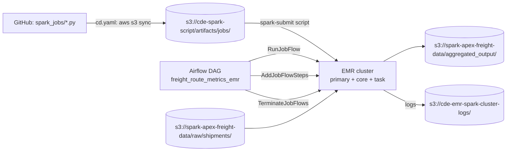
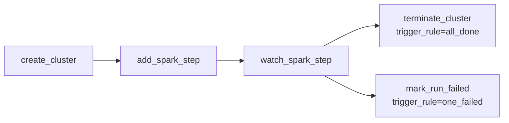

# ephemeral-spark-cluster-bootstrap

This project runs a PySpark batch job on a short-lived Amazon EMR cluster, using Apache Airflow to orchestrate it. Each DAG run creates a cluster, submits one Spark step, waits for it to finish, and then terminates the cluster whether the step succeeded or failed. You only pay for EMR while the job runs.

The example job, `freight_route_metrics`, reads raw shipment data from S3, aggregates it per route and per day, and writes partitioned Parquet back to S3.

## Contents

- [Architecture](#architecture)
- [Repository layout](#repository-layout)
- [The DAG](#the-dag)
- [EMR cluster configuration](#emr-cluster-configuration)
- [The Spark job](#the-spark-job)
- [CI/CD](#cicd)
- [Prerequisites](#prerequisites)
- [Running locally](#running-locally)
- [Configuration reference](#configuration-reference)
- [Known gaps](#known-gaps)
- [References](#references)

## Architecture



1. A push to `main` that changes `spark_jobs/*.py` uploads the job scripts to S3.
2. A user triggers the `freight_route_metrics_emr` DAG in Airflow (it has no schedule).
3. Airflow creates the EMR cluster, adds the Spark step, polls it until it ends, and terminates the cluster.

## Repository layout

```
.
├── .github/workflows/
│   ├── ci.yaml                     # Ruff lint and format check on pull requests
│   └── cd.yaml                     # Syncs spark_jobs/*.py to S3 on push to main
├── config/
│   └── airflow.cfg                 # Airflow config, mounted into the containers
├── dags/
│   ├── emr_config.py               # Cluster definition (JOB_FLOW_OVERRIDES) and Spark step
│   └── ephemeral_spark_cluster.py  # The DAG
├── spark_jobs/
│   └── freight_route_metrics.py    # The PySpark job that runs on EMR
├── docker-compose.yaml             # Local Airflow 3 stack (CeleryExecutor)
└── .env                            # AIRFLOW_UID for docker compose
```

## The DAG

File: [dags/ephemeral_spark_cluster.py](dags/ephemeral_spark_cluster.py)

| Setting | Value |
|---|---|
| `dag_id` | `freight_route_metrics_emr` |
| `schedule` | `None` (manual trigger only) |
| `start_date` | `2026-11-01` |
| `catchup` | `False` |
| `retries` | `0` |
| AWS connection | `aws_default` |
| Region | `eu-central-1` |

### Task flow



| Task | Operator | What it does |
|---|---|---|
| `create_cluster` | `EmrCreateJobFlowOperator` | Calls EMR `RunJobFlow` with `JOB_FLOW_OVERRIDES`. Pushes the cluster ID to XCom. `emr_conn_id=None`, so the cluster definition comes only from `emr_config.py` and not from an Airflow EMR connection. |
| `add_spark_step` | `EmrAddStepsOperator` | Adds `SPARK_STEPS` to the cluster. Pushes the list of step IDs to XCom. |
| `watch_spark_step` | `EmrStepSensor` | Polls the step every 30 seconds in `reschedule` mode, so it does not hold a worker slot. Times out after 3 hours. |
| `terminate_cluster` | `EmrTerminateJobFlowOperator` | Terminates the cluster. `trigger_rule="all_done"` makes it run even if an upstream task failed. |
| `mark_run_failed` | `PythonOperator` | Runs only when `watch_spark_step` fails, and raises an error so that the DAG run is marked as failed. |

### Why `mark_run_failed` exists

`terminate_cluster` is the leaf task and it succeeds even when the Spark step fails. Without another task, Airflow would mark the DAG run as successful. `mark_run_failed` fails on purpose in that case, so a failed Spark job shows as a failed DAG run, and the cluster is still terminated.

### XCom templates

The cluster and step IDs are passed between tasks with Jinja templates in [dags/emr_config.py](dags/emr_config.py):

```python
CLUSTER_ID = "{{ ti.xcom_pull(task_ids='create_cluster') }}"
STEP_ID = "{{ ti.xcom_pull(task_ids='add_spark_step')[0] }}"
```

## EMR cluster configuration

File: [dags/emr_config.py](dags/emr_config.py). `JOB_FLOW_OVERRIDES` is passed as-is to the boto3 [`run_job_flow`](https://docs.aws.amazon.com/boto3/latest/reference/services/emr/client/run_job_flow.html) call.

| Setting | Value | Notes |
|---|---|---|
| `Name` | `freight-route-metrics` | |
| `ReleaseLabel` | `emr-7.5.0` | |
| `Applications` | `Spark` | |
| `LogUri` | `s3://cde-emr-spark-cluster-logs/` | Cluster and step logs |
| `JobFlowRole` | `EMR_EC2_DefaultRole` | EC2 instance profile. Needs read and write access to the S3 buckets. |
| `ServiceRole` | `EMR_DefaultRole` | |
| `AutoTerminationPolicy.IdleTimeout` | `3600` seconds | Safety net. If Airflow fails before `terminate_cluster` runs, EMR shuts down the idle cluster after 1 hour. |
| `KeepJobFlowAliveWhenNoSteps` | `True` | The cluster starts with no steps, because the step is added by a later task. Without this, EMR would terminate the cluster at once. |
| `TerminationProtected` | `False` | Lets `terminate_cluster` end the cluster. |
| `Ec2SubnetId` | `subnet-0737ad770665b10e0` | Hard-coded. Change it for a different VPC or account. |
| `Tags` | `project=freight-route-metrics`, `orchestrator=airflow` | |

### Instance groups

EMR has three node types. See [Understand node types: primary, core, and task nodes](https://docs.aws.amazon.com/emr/latest/ManagementGuide/emr-master-core-task-nodes.html).

| Group | Role | Type | Count | Market | Purpose |
|---|---|---|---|---|---|
| `primary` | `MASTER` | `m5.xlarge` | 1 | On-Demand | Runs the YARN ResourceManager and HDFS NameNode. Coordinates the cluster. |
| `core` | `CORE` | `r5.xlarge` | 1 | On-Demand | Runs YARN NodeManager and HDFS DataNode. Hosts the Spark driver (see below). |
| `task` | `TASK` | `m5.xlarge` | 1 | On-Demand | Runs YARN NodeManager only, with no HDFS. Extra compute for executors. |

### Driver placement on CORE nodes

The step uses `--deploy-mode cluster`, so the Spark driver runs inside the YARN ApplicationMaster (AM). From EMR 6.x, AMs can be placed on task nodes. Task nodes are the nodes most likely to be removed (for example, Spot interruption or scale-in), and if the AM node goes away, the whole job fails. The `yarn-site` classification pins AMs to CORE nodes:

```python
"yarn.node-labels.enabled": "true",
"yarn.node-labels.am.default-node-label-expression": "CORE",
```

### Spark step

| Setting | Value |
|---|---|
| `ActionOnFailure` | `CONTINUE`. Airflow owns cleanup, so a failed step does not terminate the cluster by itself. |
| `Jar` | `command-runner.jar` |
| Script | `s3://cde-spark-script/artifacts/jobs/freight_route_metrics.py` |

`spark-submit` arguments:

```
--deploy-mode cluster
--conf spark.dynamicAllocation.enabled=false
--num-executors 2
--executor-cores 3
--executor-memory 4g
--driver-memory 4g
```

Dynamic allocation is off, so the job always requests exactly 2 executors with 3 cores and 4 GB each.

## The Spark job

File: [spark_jobs/freight_route_metrics.py](spark_jobs/freight_route_metrics.py)

| | Path |
|---|---|
| Input | `s3://spark-apex-freight-data/raw/shipments/` (Parquet) |
| Output | `s3://spark-apex-freight-data/aggregated_output/` (Parquet, partitioned by `year/month/day`) |

Logic:

1. Read the shipments Parquet data.
2. Drop rows where `status = 'CANCELLED'`.
3. Group by `year`, `month`, `day`, `origin_hub`, `destination_hub`, `route_id`.
4. Calculate:
   - `total_shipments`: count of `shipment_id`
   - `total_weight_lbs`: sum of `weight_lbs`, rounded to 2 decimal places
   - `avg_distance_miles`: average of `distance_miles`, rounded to 1 decimal place
5. Write with `mode("overwrite")` and `spark.sql.sources.partitionOverwriteMode=dynamic`. Only the partitions that this run writes are replaced, so reruns are safe and other days are not deleted.

## CI/CD

| Workflow | Trigger | What it does |
|---|---|---|
| [ci.yaml](.github/workflows/ci.yaml) | Pull request to `main` that changes any `*.py` | Installs Ruff on Python 3.11 and runs `ruff check` and `ruff format --check`. |
| [cd.yaml](.github/workflows/cd.yaml) | Push to `main` that changes `spark_jobs/*.py` | Runs `aws s3 sync spark_jobs/ s3://cde-spark-script/artifacts/jobs/` (only `*.py` files) in `eu-central-1`. One deploy at a time (`concurrency: spark-jobs-deploy`). |

The CD workflow needs these GitHub repository secrets:

- `AWS_ACCESS_KEY_ID`
- `AWS_SECRET_ACCESS_KEY`

Changes to the DAG files are not deployed by CD. The local Airflow stack reads `dags/` directly through a volume mount.

## Prerequisites

- Docker and Docker Compose
- An AWS account with:
  - The EMR default roles `EMR_DefaultRole` and `EMR_EC2_DefaultRole`. You can create them with `aws emr create-default-roles`.
  - The S3 buckets `cde-spark-script`, `cde-emr-spark-cluster-logs` and `spark-apex-freight-data`.
  - A subnet that matches `Ec2SubnetId` in `emr_config.py`.
  - IAM credentials for Airflow that allow at least `elasticmapreduce:RunJobFlow`, `AddJobFlowSteps`, `DescribeStep`, `DescribeCluster`, `TerminateJobFlows`, and `iam:PassRole` on the two EMR roles.
- The Spark script uploaded to `s3://cde-spark-script/artifacts/jobs/freight_route_metrics.py`, either through CD or by hand.

## Running locally

1. Set the Airflow user ID (already set in `.env` for macOS):

   ```bash
   echo "AIRFLOW_UID=$(id -u)" > .env
   ```

2. Initialise the database and create the admin user:

   ```bash
   docker compose up airflow-init
   ```

3. Start the stack:

   ```bash
   docker compose up -d
   ```

4. Open the Airflow UI at <http://localhost:8080>. The default login is `airflow` / `airflow`.

5. Create the AWS connection. In the UI, go to **Admin → Connections**, and add a connection with ID `aws_default` and type **Amazon Web Services**. Or use the CLI:

   ```bash
   docker compose run --rm airflow-cli connections add aws_default \
     --conn-type aws \
     --conn-login "<AWS_ACCESS_KEY_ID>" \
     --conn-password "<AWS_SECRET_ACCESS_KEY>" \
     --conn-extra '{"region_name": "eu-central-1"}'
   ```

6. Unpause and trigger the `freight_route_metrics_emr` DAG. New DAGs are paused by default (`DAGS_ARE_PAUSED_AT_CREATION=true`).

7. Monitor the run in Airflow. To see Spark and step logs, open the EMR console or look in `s3://cde-emr-spark-cluster-logs/<cluster-id>/`.

Optional: start Flower to monitor Celery workers at <http://localhost:5555>:

```bash
docker compose --profile flower up -d
```

To stop the stack:

```bash
docker compose down        # keep the Postgres data
docker compose down -v     # also delete the Postgres volume
```

## Configuration reference

| What | Where |
|---|---|
| Airflow image | `apache/airflow:3.4.0` (`AIRFLOW_IMAGE_NAME` overrides it) |
| Executor | `CeleryExecutor` with Redis and Postgres 16. Set in `docker-compose.yaml`, which overrides `executor = LocalExecutor` in `config/airflow.cfg`. |
| Auth manager | FAB auth manager. Set in `docker-compose.yaml`, which overrides `SimpleAuthManager` in `config/airflow.cfg`. |
| Cluster definition | `JOB_FLOW_OVERRIDES` in `dags/emr_config.py` |
| Spark step and resources | `SPARK_STEPS` in `dags/emr_config.py` |
| S3 script and log locations | `SCRIPT_URI` and `LOG_URI` in `dags/emr_config.py` |
| Job input and output paths | `INPUT_PATH` and `OUTPUT_PATH` in `spark_jobs/freight_route_metrics.py` |
| Region | `eu-central-1`, set on each operator and in `cd.yaml` |


## References

- [boto3 EMR `run_job_flow`](https://docs.aws.amazon.com/boto3/latest/reference/services/emr/client/run_job_flow.html): every field that `JOB_FLOW_OVERRIDES` accepts.
- [Amazon EMR: primary, core, and task nodes](https://docs.aws.amazon.com/emr/latest/ManagementGuide/emr-master-core-task-nodes.html): what each node type runs and how they differ.
- [Airflow Amazon provider: EMR operators](https://airflow.apache.org/docs/apache-airflow-providers-amazon/stable/_api/airflow/providers/amazon/aws/operators/emr/index.html): `EmrCreateJobFlowOperator`, `EmrAddStepsOperator`, `EmrTerminateJobFlowOperator` and the rest.
